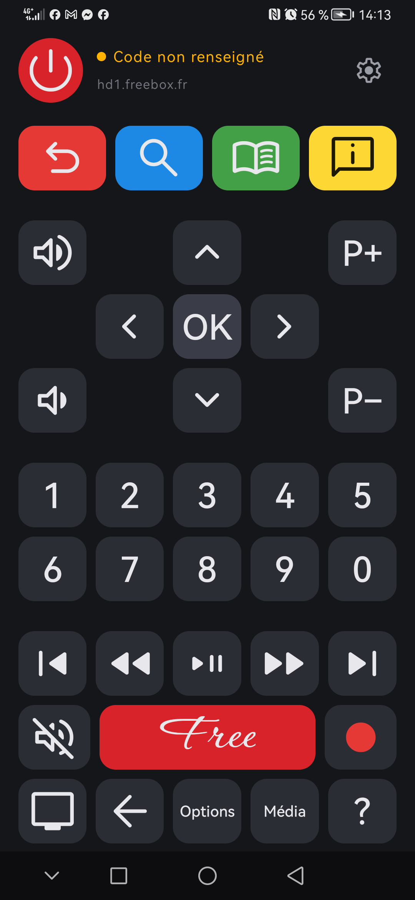

# fbx-remote

Télécommande Android pour Freebox Révolution, écrite en Kotlin et Jetpack Compose.
Une seule fonction : envoyer les touches au Player Freebox par son API HTTP locale.
Pas de publicité, pas de compte, pas de traqueur, aucun accès réseau autre que la Freebox.

<p align="center">
  
</p>

## Fonctionnement

L'application envoie des requêtes `GET` au Player sur le réseau local :

```text
http://hd1.freebox.fr/pub/remote_control?code=<code>&key=<touche>[&long=true]
```

Le code à huit chiffres est celui de la « télécommande réseau » du Player.
Un appui long sur une touche envoie la variante `long=true`.
La ligne d'état sous le bouton power indique la réponse du Player : envoyé, code refusé,
touche inconnue ou Player injoignable.

## Prérequis côté Freebox

1. Le téléphone doit être connecté au Wi-Fi de la Freebox.

2. Sur la TV : Réglages › Système › Informations Freebox Player et Server › Player ›
   Télécommande réseau. Activer la télécommande réseau et relever le code.

3. Dans l'application : roue dentée en haut à droite, saisir le code, choisir le boîtier
   (`hd1.freebox.fr` pour le premier Player, `hd2.freebox.fr` pour un second), valider.

## Compilation

Prérequis : JDK 17, SDK Android (plateforme 35), et pour la release Python 3 avec `fonttools`
(`python -m pip install fonttools`).

```bash
# version debug, police d'icônes complète (environ 23 Mo), installée sur l'appareil branché
./gradlew installDebug

# version release, police réduite aux glyphes utilisés (environ 1 Mo)
./gradlew assembleRelease
```

L'APK release est produit dans `app/build/outputs/apk/release/`. Il est pour l'instant signé
avec la clé debug du SDK, ce qui suffit pour un usage personnel ; prévoir un keystore dédié
avant toute diffusion.

Le projet s'ouvre dans IntelliJ IDEA (plugin Android) ou Android Studio. Les fonctions
`@Preview` en bas de `RemoteScreen.kt` donnent l'aperçu de l'écran et du dialogue de réglages.

## Organisation du code

| Fichier | Rôle |
|:--------|:-----|
| `app/src/main/java/fr/divad/fbxremote/FbxKey.kt` | Liste des touches et code envoyé au Player |
| `.../RemoteClient.kt` | Requête HTTP et interprétation de la réponse |
| `.../RemoteViewModel.kt`, `Prefs.kt` | État de l'écran, réglages persistants |
| `.../ui/RemoteScreen.kt` | Mise en page de la télécommande, c'est ici qu'on déplace ou ajoute des touches |
| `.../ui/KeyButton.kt` | Rendu d'une touche, tailles par défaut (`KeyDefaults`) |
| `.../ui/Theme.kt` | Couleurs et polices |
| `.../ui/Symbols.kt`, `Sym.kt` | Police Material Symbols et constantes de codepoints |
| `tools/subset_symbols.py` | Découpe de la police pour la release |

### Icônes

Les icônes sont des glyphes de la police variable Material Symbols Rounded, embarquée en
entier dans `app/src/main/res/font/`. Dans le code, un symbole se désigne par son nom du
catalogue Google en snake_case : `Sym.volume_up`, `Sym.skip_next`. Le fichier `ICONES.txt`
liste en complément les Material Icons classiques disponibles via `Icons.Default.*`.

Pour la release, la tâche Gradle `subsetSymbolsFont` scanne les sources, repère les `Sym.xxx`
utilisés et génère une police réduite qui remplace la police complète dans l'APK.
Le mécanisme est transparent : ajouter une icône dans le code suffit.

## Licences

- Code du projet : usage personnel, sans licence explicite pour l'instant.
- Material Symbols : Apache License 2.0 (Google).
- Corinthia : SIL Open Font License 1.1 (Rob Leuschke, via Google Fonts).
